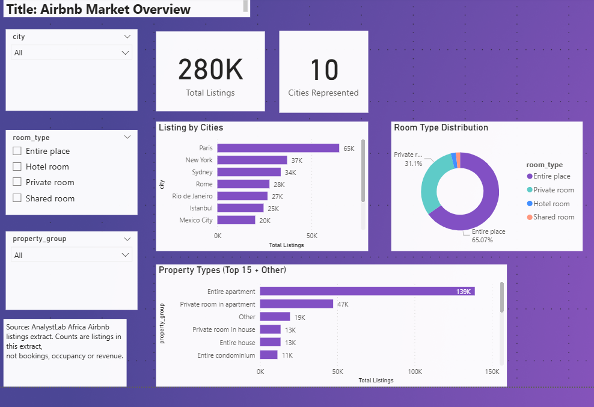
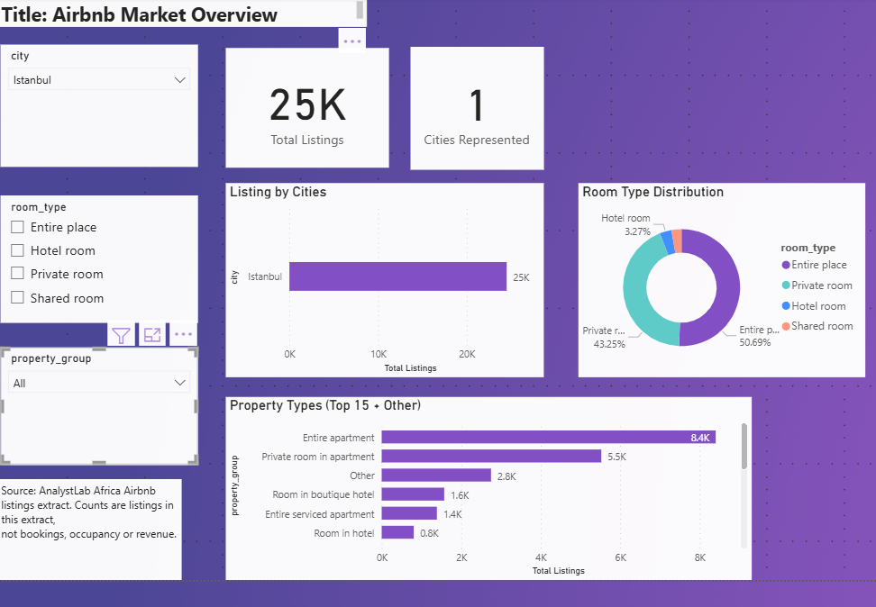
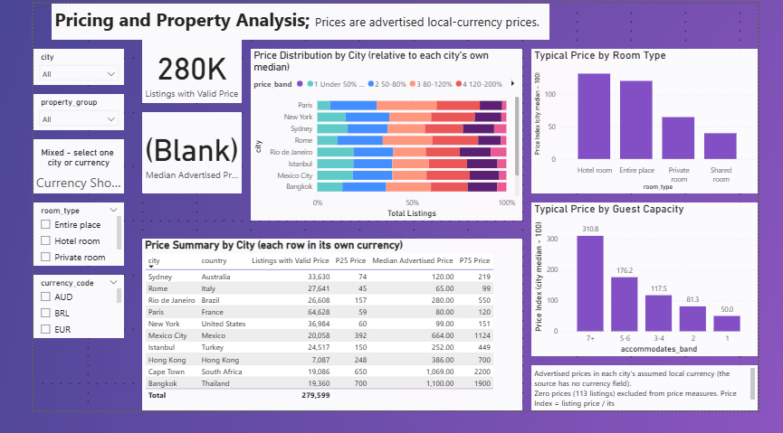
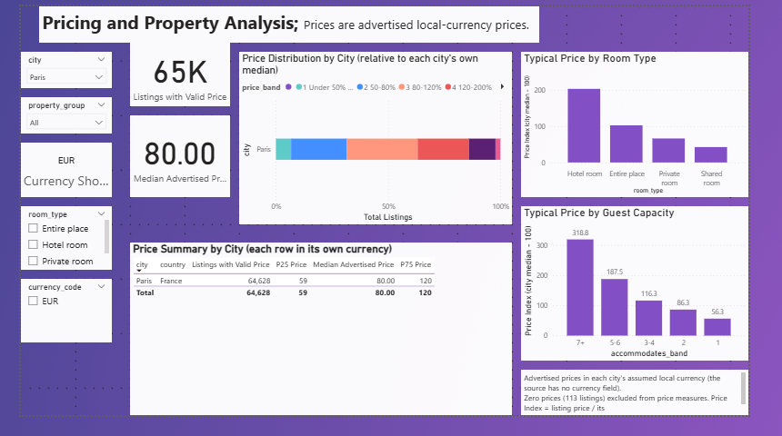
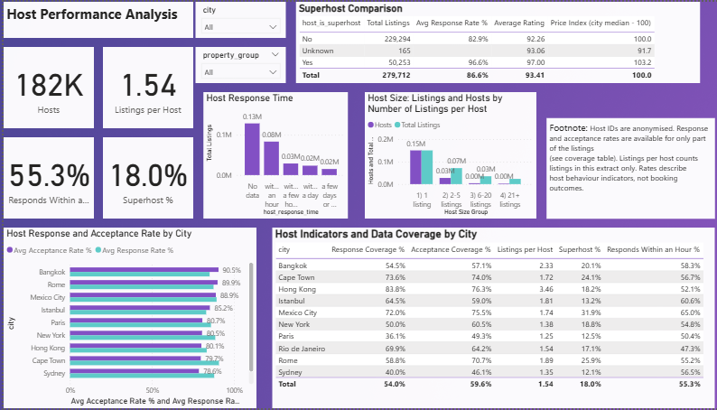
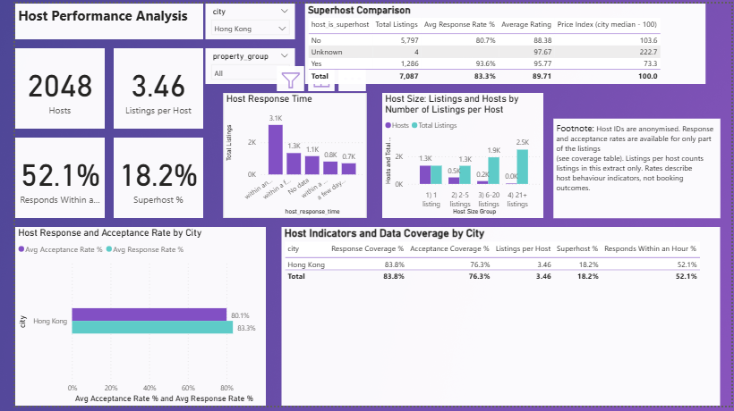
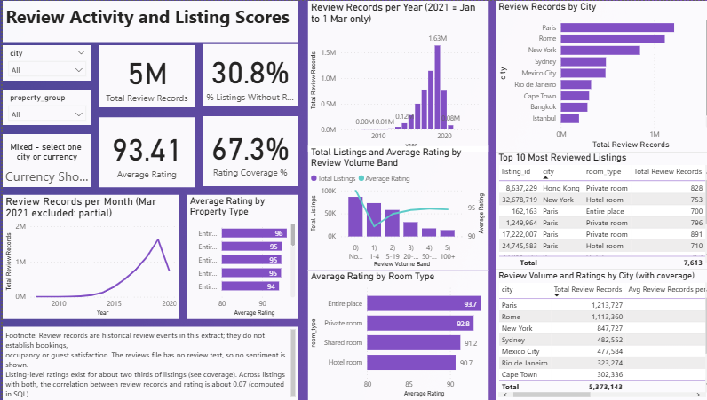
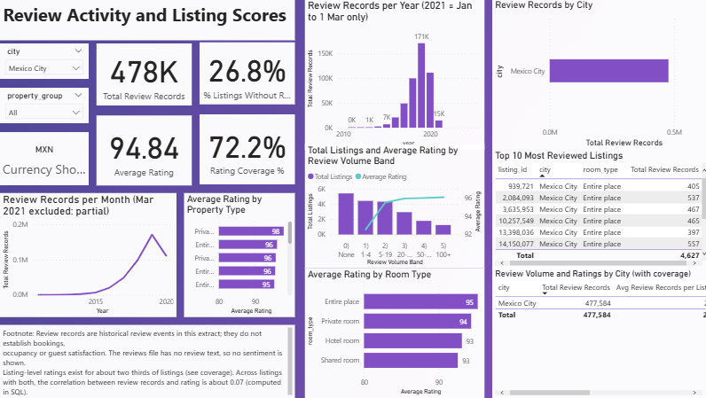

# Validation Evidence

Date: 2026-11-12  |  Project: Airbnb Market Intelligence (Track A)

## 1. Method
Each value below was recomputed with SQL directly on the RAW tables (raw_listings, raw_reviews), independently of the cleaned model and of Power BI. The dashboard value was then read from the Power BI report and compared. Counts must match exactly; medians must match exactly; averages must match at the displayed decimals.

## 2. Independent calculation checks

| ID | Check | Where to read it in the dashboard | Source value (SQL on raw) | Dashboard value 
|---|---|---|---|---|---|
| V1 | Total listings | Page 1 card Total Listings (no filters) | 279,712 | 279,712 |
| V2 | Cities represented | Page 1 card Cities Represented | 10 | 10 | 
| V3 | Total review records | Page 4 card Total Review Records (no filters) | 5,373,143 | 5,373,143 |
| V4 | % of listings without review records | Page 4 card (percent) | 30.8 | 30.8 |
| V5 | Paris listings | Page 1: City = Paris, card Total Listings | 64,690 | 64,690  |
| V6 | Hong Kong listings | Page 1: City = Hong Kong, card Total Listings | 7,087 | 7,087  |
| V7 | Hotel room listings | Page 1: Room type = Hotel room, card Total Listings | 5,857 | 5,857  |
| V8 | Median advertised price, Paris (EUR, price > 0) | Page 2: City = Paris, card Median Advertised Price | 80 | 80  |
| V9 | Median advertised price, Hong Kong (HKD, price > 0) | Page 2: City = Hong Kong, card Median Advertised Price | 386 | 386 |
| V10 | Review records, Paris | Page 4: City = Paris, card Total Review Records | 1,213,727 | 1,213,727 |
| V11 | Review records dated 2020 | Page 4 year chart, hover over 2020 | 755,324 | 755,324 |
| V12 | Distinct hosts | Page 3 card Hosts (no filters) | 182,024 | 182,024  |
| V13 | Average host response rate %, Hong Kong | Page 3: City = Hong Kong, Avg Response Rate % | 83.3 | 83.3 |
| V14 | Average listing rating (all listings with a rating) | Page 4 card Average Rating | 93.41 | 93.41  |
| V15 | Average review records per listing, Mexico City | Page 4 city table, Mexico City row | 23.8 | 23.8  |
| V16 | Listings with a valid price (price > 0) | Page 2 card Listings with Valid Price (no filters) | 279,599 | 279,599  |

## 3. Filter-response tests
Set the slicers on Page 1 (they are synced to Page 4). Read Total Listings on Page 1 and Total Review Records on Page 4.

| ID | Filters selected | Expected listings | Dashboard listings | Expected review records | Dashboard review records | 
|---|---|---|---|---|---|---|
| F1 | City = Paris; Room type = Private room | 7,492 | | 174,892 | 
| F2 | City = Paris and Rome | 92,337 | 2,327,087 | 
| F3 | City = New York; Room type = Hotel room | 299 | 9,779 | 
| F4 | City = Rome; Property group = Entire apartment | 14,445 | 720,931 | 
| F5 | City = Sydney; Room type = Entire place; Property group = Entire house | 4,821 | 49,558 | 

## 4. Behaviour checks (tick when confirmed)
- [ ] Clearing all filters returns Total Listings 279,712 and Total Review Records 5,373,143
- [ ] City, Room type and Property group slicers are synced across all four pages
- [ ] Sum of the city rows in the city tables equals the card totals
- [ ] Median price shows blank (not a number) when more than one currency is selected
- [ ] Selecting a bar in one chart cross-filters the other charts
- [ ] Top 10 most reviewed listings table shows exactly 10 rows (first row 891 records, listing 17222007)

## 5. Data-preparation reconciliation
Automatic checks in script/03_build_model.py compared the model to the raw tables (row counts, review totals, zero-price flags, orphan checks). See docs/stage4_output.txt.

## 6. Discrepancies found and how they were resolved

| # | Issue | How it was found | Cause | Resolution |
|---|---|---|---|---|
| 1 | Listings.csv failed to load | DuckDB error at line 11,877 | 981 lines with invalid UTF-8 bytes | Repaired UTF-8 copy created; no rows removed; counts reconciled to the brief |
| 2 | 160 repeated review_id values | Key check | Same review_id used for two different listings (same date and reviewer) | All rows kept; listing_id + review_id is unique; affected listings flagged |
| 3 | dim_city header shown as a data row (Column3) | First dashboard test table | Power BI could not detect a header in an all-text file | First row promoted to headers; 10 rows confirmed |
| 4 | Median shown on the Total row (150) | First dashboard test table | Median across ten currencies is meaningless | Measure returns blank unless exactly one currency is selected |
| 5 | New columns missing after refresh | Field search in Power BI | Import step fixed at 42 columns | Updated import to 44 columns |
| 6 | PERCENTILE error and text-typed numbers | Power BI error message | Column types lost after the import change | Explicit data types set for every column |
| 7 | Guest capacity chart missing bars | Visual review against SQL results | accommodates_band typed as number | Column typed as text; five bars confirmed |
| 8 | Top 10 table listed every listing; volume chart included the no-records band; monthly chart showed years | Visual review against SQL results | Visual filters or axis settings not applied | Filters and axis re-applied; values re-checked against SQL |

## 7. Limitations that affect interpretation
- Prices are advertised prices; the source has no currency field, so each city's currency is an assumption from its country. No conversion was done and prices are never compared across currencies.
- Advertised price is not revenue; review records are not bookings, occupancy or guest satisfaction; no review text exists, so no sentiment analysis.
- 113 listings with a price of 0 are excluded from price measures only.
- Review scores exist for about 67% of listings; host response and acceptance data are missing for 40-46% (coverage varies by city and is shown beside averages).
- 2021 contains data only to 1 March 2021; March 2021 is excluded from the monthly chart.
- District is 87% missing, so neighbourhood is used; neighbourhood definitions differ by city.
- Host IDs are anonymised; reviewer IDs are not exported.
- The listings extract is a snapshot; counts describe this extract, not total Airbnb inventory.

## 8. Screenshot evidence (dashboard/screenshots)
, , , , , , , .